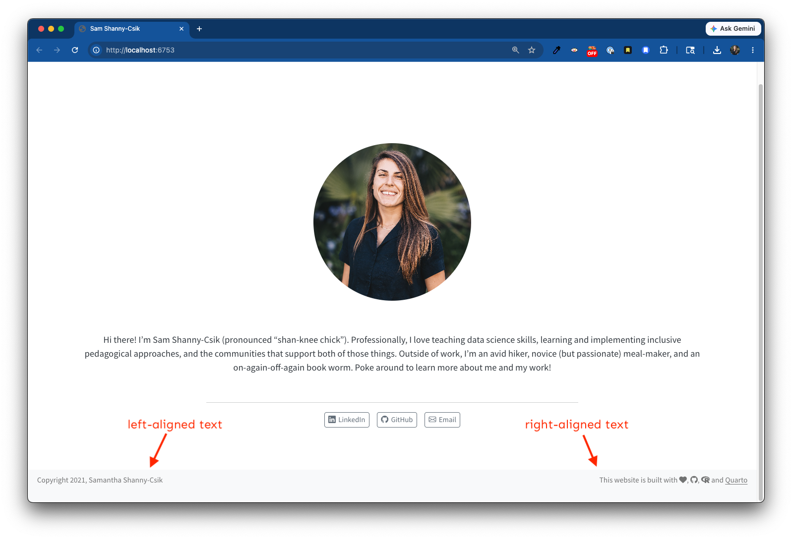
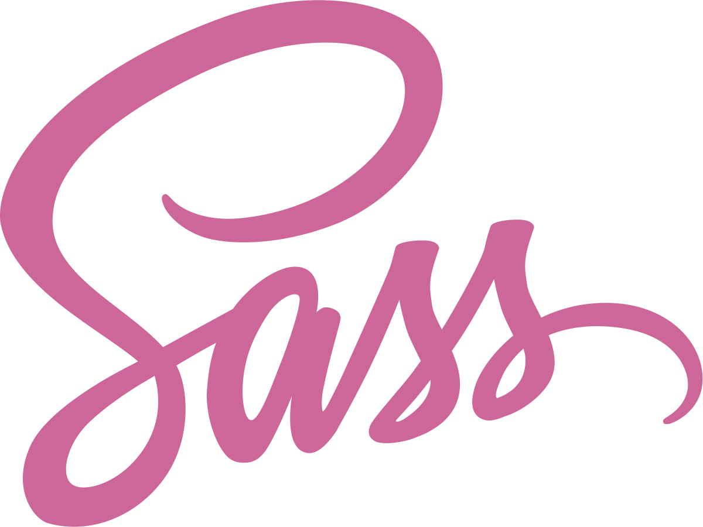
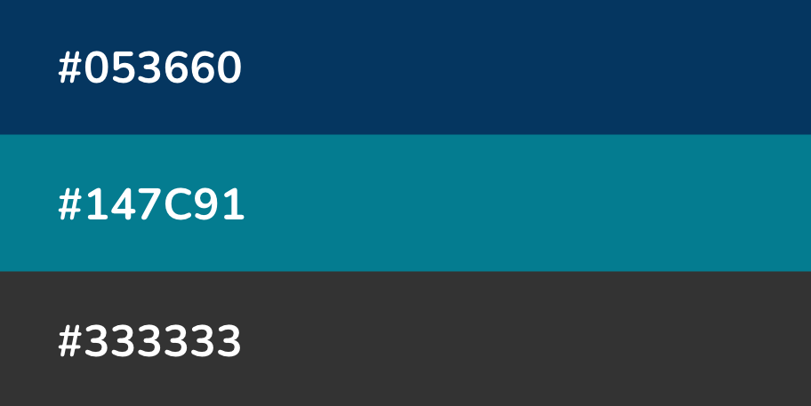
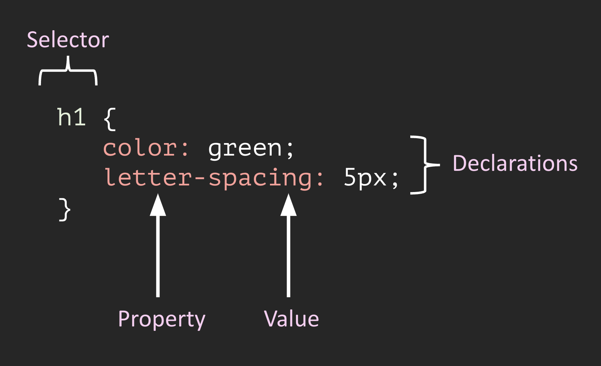
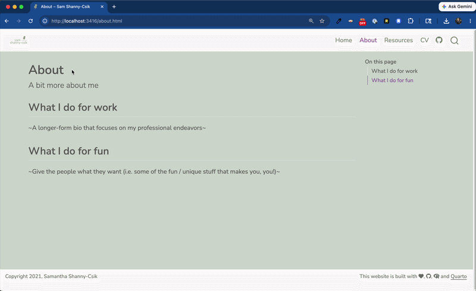
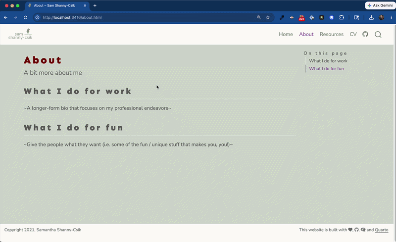

---
format:
  revealjs:
    slide-number: true
    code-link: true
    highlight-style: a11y
    chalkboard: true
    theme:
      - meds-slides-styles.scss
    footer: "Customizing Quarto Websites | [](https://github.com/UCSB-MEDS/customizing-quarto-websites){target='_blank'}"
    navigation-mode: linear
    progress: true
    controls: true
    controls-layout: bottom-right
---

## {#title-slide data-menu-title="Title Slide" background="#053660"}

[Customizing Quarto Websites]{.custom-title}

[*Make your website stand out using  & *]{.custom-subtitle}

<hr class="hr-teal">

:::: {.columns}

::: {.column width="50%"}
[Sam Shanny-Csik |]{.custom-subtitle2}<br>
*[Lecturer & Data Science Programs Manager]{.custom-subtitle3}*
:::

::: {.column width="50%"}
[Master of Environmental Data Science |]{.custom-subtitle2}<br>
[*Bren School of Environmental Science & Management*]{.custom-subtitle3}
:::

::::

<br>

::: {.title-footer}
Slides & source code available on [GitHub ](https://github.com/UCSB-MEDS/customizing-quarto-websites){target="_blank"}
:::

---

## {#prerequisites data-menu-title="Prerequisites"}

[ Prerequisites]{.slide-title}

<hr>

::: {.body-text}
You should already have a Quarto website (or at least the bones of one) that:
:::

::: {.body-text}
- is deployed using GitHub Pages **and**
- contains *some* content (e.g. text, headings, etc.) for us to customize
:::

<br>

::: {.body-text}
Run `quarto preview` in the Terminal to view changes in near real time – each time you edit and save your work, the preview will update in your browser.
:::

::: {.footer}
**If you first need to get your website up and running, follow along with these [step-by-step instructions](https://ucsb-meds.github.io/creating-quarto-websites/){target="_blank"} before moving forward.**
:::

---

## {#tldr data-menu-title="TL;DR"}

[TL;DR – our approach today]{.slide-title}

<hr>

When we **render** a Quarto site, it converts markdown to HTML and applies a pre-built CSS stylesheet (Bootswatch [Cosmo](https://bootswatch.com/cosmo/){target="_blank"}).

<br>

[We'll customize our websites in this order:]{.body-text-m .teal-text}

::: incremental
- [**First**]{.teal-text} — add a [pre-built template](https://quarto.org/docs/websites/website-about.html#templates){target="_blank"} to `index.qmd` and adjust website configurations by editing `_quarto.yml`

- [**Next**]{.teal-text} — create a `styles.scss` file, link to it in `_quarto.yml`, and define Sass variables

- [**Finally**]{.teal-text} — make fine-tuned adjustments by writing CSS rules in `styles.scss`
:::

---

##  {#edit-quarto-yml data-menu-title="## Edit YAML ##" background="#053660"}

<div class="vertical-center">
<center><div class="custom-subtitle2">First, add a [pre-built template](https://quarto.org/docs/websites/website-about.html#templates){target="_blank"} to `index.qmd` and adjust website configurations by editing `_quarto.yml`</div></center>
</div>

---

## {#add-template data-menu-title="Add a landing page template"}

[Arrange landing page content using a pre-built template]{.slide-title3}

<hr>

Quarto has [5 pre-built "about page" templates](https://quarto.org/docs/websites/website-about.html){target="_blank"} that work especially well for personal websites. Apply one in your `index.qmd` YAML:

```{r filename="index.qmd"}
#| eval: false
#| echo: true
#| code-line-numbers: false
---
image: file/path/to/headshot.jpeg
toc: false
about:
  template: jolla
  image-shape: round
  image-width: 17em
  links:
    - text: LinkedIn
      href: https://www.linkedin.com/in/yourname/
      target: _blank
    - text: GitHub
      href: https://github.com/yourusername
      target: _blank
    - text: Email
      href: mailto:you@email.com
---
```

::: {.footer}
**Tip:** Add icons to buttons using the `icon` option (e.g. `icon: linkedin`). Find free icons on [FontAwesome](https://fontawesome.com/search?o=r&m=free){target="_blank"}.
:::

---

## {#add-pages data-menu-title="Add / arrange pages"}

[Add / arrange pages in your navbar]{.slide-title}

<hr>

Configure website navigation under `website` > `navbar` in `_quarto.yml`:

```{r filename="_quarto.yml"}
#| eval: false
#| echo: true
#| code-line-numbers: "5-18"
project:
  type: website
  output-dir: docs

website:
  title: "Your Name"
  navbar:
    right:
      - href: index.qmd
        text: Home
      - about.qmd
      - href: resources.qmd
        text: Resources
      - href: file/path/to/myCV.pdf
        text: CV
        target: _blank
      - icon: github
        href: https://github.com/yourusername
        target: _blank
  page-footer:
    background: light
    left: Copyright 2024, Your Name
    right: Built with [Quarto](https://quarto.org/){target=_blank}

format:
  html:
    theme: cosmo
    css: styles.css
    toc: true
    page-layout: full
```

---


## {#page-footer1 data-menu-title="Add page footer (rendered)"}

[Add a page footer]{.slide-title}

<hr>

Footers appear on each page (you may have to scroll to the bottom to see it appear). You can include a mix of text, icons, logos, hyperlinks, etc.

```{r}
#| eval: true 
#| echo: false
#| fig-align: "center"
#| out-width: "65%" 

```

::: {.footer}
**Note:** If you plan to use FontAwesome icons *outside* of the `icon` YAML option, you'll need to first install the Quarto [fontawesome extension](https://quarto.org/docs/websites/website-about.html){target="_blank"} (more info on the next few slides).
:::

---

## {#add-footer2 data-menu-title="Add page footer (code)"}

[Add a page footer]{.slide-title}
<!-- [Configure your page footer in `_quarto.yml`]{.slide-title2} -->

<hr>

Make edits to a website's footer under the `website` > `page-footer` option:

```{r}
#| eval: false
#| echo: true
#| code-line-numbers: "20-23"
project:
  type: website
  output-dir: docs

website:
  title: "Sam Shanny-Csik"
  navbar:
    right:
      - href: index.qmd
        text: Home
      - about.qmd
      - href: resources.qmd
        text: Resources
      - href: cv/myCV.pdf
        text: CV
        target: _blank 
      - icon: github 
        href: https://github.com/yourUserName
        target: _blank
  page-footer:
    background: light # or `dark` or omit this option altogether (footer color will match page body color)
    left: Copyright 2021, Samantha Shanny-Csik
    right: This website is built with , [](https://github.com/samanthacsik/samanthacsik.github.io){target=_blank}, [](https://www.r-project.org/about.html){target=_blank} and [Quarto](https://quarto.org/){target=_blank}

format:
  html:
    theme: cosmo
    css: styles.css
    toc: true
    page-layout: full
```

---

## {#fa-extension data-menu-title="fontawesome extension"}

[Install the Quarto [fontawesome extension](https://github.com/quarto-ext/fontawesome){target="_blank"} to use icons outside of YAML]{.slide-title3}

<hr>

<br>

Run the following in your Terminal (from your project's root directory). Be sure to push the resulting `_extensions/` folder to GitHub:

```{bash filename="Terminal"}
#| eval: false
#| echo: true
#| code-line-numbers: false
quarto add quarto-ext/fontawesome
```

<br>

Then use icons anywhere in your `.qmd` files with the shortcode:

```{.markdown}
{}
{}
```

---

##  {#use-sass data-menu-title="## Use Sass ##" background="#053660"}

<div class="vertical-center">
<center><div class="custom-subtitle2">Next, create a `styles.scss` file, link to it in `_quarto.yml`, and define Sass variables.</div></center>
</div>

---

## {#what-is-sass data-menu-title="What is Sass?"}

[What is [Sass](https://sass-lang.com/){target="_blank"}?]{.slide-title}

<hr>

:::: {.columns}
::: {.column width="50%"}
<br>

```{r}
#| eval: true
#| echo: false
#| fig-align: "center"
#| out-width: "50%"

```

::: {.body-text-xl .teal-text .center-text}
**S**yntactically **A**wesome **S**tyle**s**heets
:::
:::

::: {.column width="50%"}
<br><br><br><br>

::: {.body-text}
- A **CSS extension** (adds features like variables)
- **`.scss`** is Sass's modern file format — a *superset of CSS*, meaning all valid CSS is also valid SCSS
- A **CSS preprocessor** (converts `.scss` to CSS — browsers can't read SCSS directly, but Quarto handles this conversion automatically)
:::
:::

::::

---


## {#why-use-sass1 data-menu-title="Sass reduces repetition"}

[Sass helps to reduce repetition]{.slide-title}

<hr>

::: {.body-text}
Sass extends existing CSS features in a number of exciting ways, but importantly **reduces repetition**. For example, let’s say you’re building a website / web page that uses three colors:
<!-- Stylesheets (e.g. `.css` files) are getting larger and more complex. Sass extends existing CSS features and importantly, reduces repetition. For example, let's say you're working on a website, which uses 3 main colors: -->
:::

<br>

```{r}
#| eval: true 
#| echo: false
#| fig-align: "center"
#| out-width: "10%" 

```

<br>

::: {.body-text .topbr}
You might imagine how often you'll need to type those HEX codes out as you developing your stylesheet...it can get annoying rather quickly.
:::

---

## {#why-use-sass2 data-menu-title="Define Sass variables"}

[Define Sass variables to reduce repetition]{.slide-title2}

<hr>

Sass allows us to **define variables** (in the form `$var-name: value;`) for our colors, which we can reference *instead* of writing out their HEX codes each time. This makes your stylesheet **more readable and easier to update** (e.g. only need to update HEX codes in one spot, not multiple!).

```{sass filename="Example stylesheet (.scss)"}
//| eval: false
//| echo: true
//| code-line-numbers: false
// define Sass vars 
$darkblue: #053660;
$teal: #147C91;
$darkgray: #333333;

// use vars in CSS rules (we'll learn more about how to write CSS soon!) 
h1 {
  color: $darkblue;
}

.button-styling {
  background: $teal;
  color: $darkblue; 
  border-color: $darkgray;
}
```

::: {.footer}
**Note:** Sass has two syntaxes – SCSS syntax (`.scss`), shown above, is the most common. It stands for **S**assy **C**ascading **S**tyle**s**heets 
:::

---

## {#quarto-compiles data-menu-title="Quarto compiles Sass automatically"}

[Quarto automatically compiles Sass]{.slide-title}

<hr>

<br>

::: {.center-text}
Web browsers can interpret CSS ([]{.teal-text} `.css`) but *not* Sass ([]{.teal-text} `.scss` or `.sass`). 
:::

. . . 

<br>

::: {.center-text}
Typically, you’d need to **compile (i.e. convert) Sass to CSS**, then link the resulting `.css` file in your HTML.
:::

. . . 

<br>

::: {.center-text}
Lucky for us, **Quarto compiles the contents of a `.scss` file into CSS without any extra steps** -- all we need to do is link to a `.scss` file directly in our website's `_quarto.yml`. 
:::

. . . 

<br>

::: {.body-text-xl .teal-text .center-text}
Let's create our website's `.scss ` stylesheet.
:::

---

## {#create-link-scss data-menu-title="Create & link .scss file"}

[Create & link your `.scss` file]{.slide-title}

<hr>

[**1.**]{.teal-text} Create a `.scss` file in your repo's root directory:

```{bash filename="Terminal"}
#| eval: false
#| echo: true
#| code-line-numbers: false
touch styles.scss
```

[**2.**]{.teal-text} Add the required region decorator to the top of `styles.scss`:

```{sass filename="styles.scss"}
//| eval: false
//| echo: true
//| code-line-numbers: false
/*-- scss:defaults --*/
```

[**3.**]{.teal-text} Link `styles.scss` in `_quarto.yml` under `format` > `html` > `theme`:

```{r filename="_quarto.yml"}
#| eval: false
#| echo: true
#| code-line-numbers: false
format:
  html:
    theme: styles.scss  # replaces `css: styles.css`
    toc: true
    page-layout: full
```

::: {.footer}
**Critical:** The `/*-- scss:defaults --*/` decorator is required — Quarto won't recognize your file without it.
:::

---

## {#define-sass-vars data-menu-title="Define Sass variables"}

[Define color & Quarto Sass variables]{.slide-title}

<hr>

[**4.**]{.teal-text} Define your own color variables, then assign them to [Quarto's pre-defined Sass variables](https://quarto.org/docs/output-formats/html-themes.html#sass-variables){target="_blank"}:

```{sass filename="styles.scss"}
//| eval: false
//| echo: true
/*-- scss:defaults --*/

// Colors (define your palette)
$dark-green: #858E79;
$light-green: #D1D9CE;
$cream: #FDFBF7;
$gray: #64605f;
$purple: #9158A2;
$orange: #ad7237;

// Assign to Quarto Sass variables
$navbar-bg: $cream;        // navbar background
$navbar-fg: $dark-green;   // navbar text/icons
$navbar-hl: $purple;       // navbar hover highlight
$body-bg: $light-green;    // page background
$body-color: $gray;        // page text
$footer-bg: $cream;        // footer background
$link-color: $purple;      // hyperlinks
$code-bg: $cream;          // inline code background
$code-color: $purple;      // inline code text
```

---

## {#explore-fonts data-menu-title="Import Google Fonts"}

[Import Google Fonts into `styles.scss`]{.slide-title}

<hr>

[**5a.**]{.teal-text} Browse [fonts.google.com](https://fonts.google.com/){target="_blank"}, choose 1–2 font families, click **Get Font** for each, then click **Get embed code** > choose **@import** > copy the import statement.

[**5b.**]{.teal-text} Paste it into `styles.scss` directly beneath `/*-- scss:defaults --*/`:

```{sass filename="styles.scss"}
//| eval: false
//| echo: true
//| code-line-numbers: "3-4"
/*-- scss:defaults --*/

// Import Google fonts
@import url('https://fonts.googleapis.com/css2?family=Nunito:ital,wght@0,200..1000;1,200..1000&family=Sen:wght@400..800&display=swap');

// Colors
$dark-green: #858E79;
// ...
```

[**5c.**]{.teal-text} Set your main (default) font in `_quarto.yml`:

```{r filename="_quarto.yml"}
#| eval: false
#| echo: true
#| code-line-numbers: false
format:
  html:
    theme: styles.scss
    mainfont: Nunito  # applies to all text elements site-wide
    toc: true
    page-layout: full
```

---

##  {#refining data-menu-title="## Refine with CSS ##" background="#053660"}

<div class="vertical-center">
<center><div class="custom-subtitle2">Finally, make fine-tuned adjustments by writing CSS rules in `styles.scss`</div></center>
</div>

---

## {#html-css-basics data-menu-title="HTML & CSS basics"}

[HTML & CSS are the building blocks of web pages]{.slide-title2}

<hr>

::: {.body-text-s}
**HTML** is a markup language that structures web content — think of it as the *skeleton* of a web page (headings, paragraphs, links, images, etc.).
:::

::: {.body-text-s}
**CSS** controls how HTML elements *look* — colors, fonts, layout, spacing. It's the *outfit* styling the skeleton.
:::

<br>

[CSS is **rule-based**: you select elements and declare how they should look.]{.body-text-m .teal-text}

```{r}
#| eval: true
#| echo: false
#| fig-align: "center"
#| out-width: "60%"

```

- [**Selector**]{.teal-text} — which HTML element(s) to style (e.g. `h1`)
- [**Property**]{.teal-text} — what to change (e.g. `color`)
- [**Value**]{.teal-text} — how to change it (e.g. `green`)

---

## {#html-css-scss-relationship data-menu-title="HTML, CSS & SCSS relationship"}

[How HTML, CSS, and SCSS fit together]{.slide-title}

<hr>

:::: {.columns}

::: {.column width="60%"}

::: {.body-text-s}
**HTML** defines your content and structure — elements like `<h1>`, `<p>`, `<div>` tell the browser *what* is on the page.
:::

::: {.body-text-s .topbr}
**CSS** targets those HTML elements and controls how they *look*. A CSS stylesheet is linked to an HTML document so the browser knows which styles to apply.
:::

::: {.body-text-s .topbr}
**SCSS** is a superset of CSS — all valid CSS is also valid SCSS, but SCSS adds extra features like **variables** (`$color: red;`) and **nesting**. Browsers can't read `.scss` directly; it must be compiled to `.css` first.
:::

::: {.body-text-s .topbr}
**Quarto handles all of this for you:**

- Your `.qmd` files are converted to **HTML**
- Your `styles.scss` is compiled to **CSS** and linked to that HTML
- The result is a styled webpage in your browser
:::

:::

::: {.column width="40%"}

<br>

::: {.center-text .body-text-s}
```
you write:          browser reads:

index.qmd      →    index.html
styles.scss    →    styles.css
                         ↕
                    styled webpage
```
:::

<br>

::: {.body-text-s .teal-text .center-text}
**This is why we write CSS rules inside `styles.scss` — Quarto compiles it and wires everything up automatically.**
:::

:::

::::

---


##  {#html-elements2 data-menu-title="Commonly used HTML tags"}

[Commonly used HTML tags]{.slide-title}

<hr>


::: {.center-text .body-text-m}
Browse a complete [list of HTML tags](https://www.w3schools.com/tags/default.asp){target="_blank"}.
:::

<br>

| Tag                 | What it does                                                 |
|---------------------|--------------------------------------------------------------|
| `<div></div>`       | defines a division or section in an HTML document            |
| `<h1></h1>`         | create a first-level heading (largest)                       |
| `<h6></h6>`         | create a sixth-level heading (smallest)                      |
| `<p></p>`           | begin a new paragraph                                        |
| `<strong></strong>` | bold text                                                    |
| `<em></em>`         | italicized text                                              |
| `</img>`       | present an image                                             |
| `<a></a>`           | define a hyperlink                                           |
| `<br>`              | add a line break (empty element)                             |
| `<span></span>`     | an inline container used to markup part of a text or document|

::: {.footer}
**Note:** Some HTML elements have no content (e.g. the `<br>`, or "break" element) -- these are called *empty* elements and do not have an end tag.
:::

---

## {#selector-types data-menu-title="Key selector types"}

[The selector types you'll use most]{.slide-title}

<hr>

**Element** — `h1 { color: green; }` styles *every* `<h1>` on the page:

:::: {.columns}
::: {.column width="50%"}
```{.html}
<h1>My heading</h1>
<p>A paragraph</p>
```
:::
::: {.column width="50%"}
::: {style="border:2px solid #ddd; border-radius:6px; padding:8px 12px; background:#fafafa; font-size:0.8em;"}
<p style="color:green; font-weight:700; margin:0 0 6px;">My heading</p>
<p style="margin:0;">A paragraph</p>
:::
:::
::::

**Grouping** — `h1, h2 { color: purple; }` applies the same styles to both tags:

:::: {.columns}
::: {.column width="50%"}
```{.html}
<h1>Heading 1</h1>
<h2>Heading 2</h2>
<h3>Heading 3</h3>
```
:::
::: {.column width="50%"}
::: {style="border:2px solid #ddd; border-radius:6px; padding:8px 12px; background:#fafafa; font-size:0.8em;"}
<p style="color:purple; font-weight:700; margin:0 0 4px;">Heading 1</p>
<p style="color:purple; font-weight:600; margin:0 0 4px;">Heading 2</p>
<p style="margin:0;">Heading 3</p>
:::
:::
::::

**Class** — `.blue-text { color: blue; }` only targets elements with `class="blue-text"`:

:::: {.columns}
::: {.column width="50%"}
```{.html}
<p class="blue-text">Styled</p>
<p>Not styled</p>
```
:::
::: {.column width="50%"}
::: {style="border:2px solid #ddd; border-radius:6px; padding:8px 12px; background:#fafafa; font-size:0.8em;"}
<p style="color:blue; font-style:italic; margin:0 0 6px;">Styled</p>
<p style="margin:0;">Not styled</p>
:::
:::
::::

---


## {#scss-rules data-menu-title="Add scss:rules section"}

[Add a CSS rules section to `styles.scss`]{.slide-title}

<hr>

Add the `/*-- scss:rules --*/` region decorator beneath your Sass variables (**required** — CSS rules won't be recognized without it):

```{sass filename="styles.scss"}
//| eval: false
//| echo: true
//| code-line-numbers: "11"
/*-- scss:defaults --*/

@import url('https://fonts.googleapis.com/css2?family=Nunito:ital,wght@0,200..1000;1,200..1000&family=Sen:wght@400..800&display=swap');

$dark-green: #858E79;
// ... additional Sass variables ...
$link-color: $purple;

/*-- scss:rules --*/

/* Write your CSS rules below here */
```

---

## {#use-inspect data-menu-title="Use Inspect to identify elements"}

[Use Inspect to figure out what to target]{.slide-title2}

<hr>

:::: {.columns}
::: {.column width="50%"}
<br>

```{r}
#| eval: true 
#| echo: false
#| fig-align: "center"
#| out-width: "100%" 

```

:::
::: {.column width="50%"}
<br>
<br>

::: {.body-text-s}
In your website preview, **right click on an element of interest** (in this case, let's start with the page title, "About") and **choose Inspect** to pull up the underlying HTML & CSS files. You can continue to right click / inspect additional elements (e.g. the section header, "What I do for work").
:::

::: {.body-text-s}
Hovering your mouse over different lines of HTML highlights the corresponding element on your webpage.
:::
:::
::::

---

## {#write-css-rules data-menu-title="Write CSS rules"}

[Write CSS rules in your `styles.scss`]{.slide-title}

<hr>

**Example: style all `<h1>` and `<h2>` elements site-wide**

```{sass filename="styles.scss"}
//| eval: false
//| echo: true
//| code-line-numbers: "3-6"
/*-- scss:rules --*/

h1, h2 {
  letter-spacing: 5px;
  font-weight: 800;
}
```

**Example: modify Quarto's pre-assigned `.title` class** (applied to page titles):

```{sass filename="styles.scss"}
//| eval: false
//| echo: true
//| code-line-numbers: "8-10"
/*-- scss:rules --*/

h1, h2 {
  letter-spacing: 5px;
  font-weight: 800;
}

.title {
  color: maroon;
}
```

::: {.footer}
**Tip:** No HTML edits needed for element selectors — they apply automatically to all matching elements across your site.
:::

---

## {#write-own-class-selector data-menu-title="Write your own class selectors"}

[Write your own class selectors and apply them in `.qmd` files]{.slide-title3}

<hr>

**Define the class in `styles.scss`:**

```{sass filename="styles.scss"}
//| eval: false
//| echo: true
//| code-line-numbers: false
.center-text { text-align: center; }
.orange-text { color: $orange; }
```

**Apply using HTML syntax or Quarto's div/span syntax in `.qmd` files:**

:::: {.columns}

::: {.column width="50%"}
::: {.center-text}
**HTML syntax**
:::
```{.html}
<!-- Block element (div) -->
<div class="center-text">
  Centered content
</div>

<!-- Inline (span) -->
<p>Some <span class="orange-text">orange</span> text</p>
```
:::

::: {.column width="50%"}
::: {.center-text}
**Quarto syntax**
:::
```{.md}
<!-- Block (div) -->
::: {.center-text}
Centered content
:::

<!-- Inline (span) -->
Some [orange]{.orange-text} text
```
:::

::::

---

## {#apply-second-font data-menu-title="Apply a second font family"}

[Apply a second font with a Sass variable + CSS rule]{.slide-title3}

<hr>

To use a second imported font on specific elements (e.g. all headers), create a Sass variable and write a CSS rule:

```{sass filename="styles.scss"}
//| eval: false
//| echo: true
//| code-line-numbers: "6-7|13-15"
/*-- scss:defaults --*/

@import url('https://fonts.googleapis.com/css2?family=Nunito:ital,wght@0,200..1000;1,200..1000&family=Sen:wght@400..800&display=swap');

// Fonts
$sen: "Sen", sans-serif;

// Colors + Quarto Sass variables omitted for brevity ...

/*-- scss:rules --*/

h1, h2, h3, h4, h5, h6 {
  font-family: $sen;
}
```

::: {.footer}
**Tip:** Find the correct `font-family` value on Google Fonts under **Get embed code** > **@import** > look for the `font-family:` property in the CSS class example.
:::

---

##  {#get-inspired data-menu-title="Get inspired" background="#053660"}

<div class="page-center">
<div class="custom-subtitle"> Get inspired & keep going</div>
</div>

---

## {#tips data-menu-title="Tips for styling"}

[Tips for styling your site]{.slide-title}

<hr>

:::: {.columns}

::: {.column width="50%"}

::: {.body-text}
It's **a lot** of trial and error! Some things that help:

- Re-render often to confirm your Sass/CSS is working
- **Right-click > Inspect** to temporarily try CSS changes live in DevTools — changes are not saved, but it's great for testing
- Google (e.g. "CSS underline text", "CSS rounded corners")
- [W3Schools](https://www.w3schools.com/css/default.asp){target="_blank"} for interactive tutorials
- Browse open-source Quarto sites on GitHub for inspiration and borrow CSS rules
:::

:::

::: {.column width="50%"}

```{r}
#| eval: true
#| echo: false
#| fig-align: "center"
#| out-width: "70%"

```

::: {.body-text-s .gray-text .center-text}
Temporarily "edit" CSS in the DevTools pane to test styles before hard-coding them
:::

:::

::::

---

## {#TheEnd data-menu-title="~End Slide~"}

::: {.slide-title .center-text}
Happy Styling!
:::

```{r}
#| eval: true
#| echo: false
#| fig-align: "center"
#| out-width: "50%"

```

::: {.center-text .body-text-l .gray-text}
This is a Quarto Presentation. To learn more, visit <https://quarto.org>.
:::

::: {.center-text .body-text-s .gray-text}
*If you see mistakes or want to suggest changes, please create an [issue](https://github.com/UCSB-MEDS/customizing-quarto-websites/issues) on the source repository.*
:::
